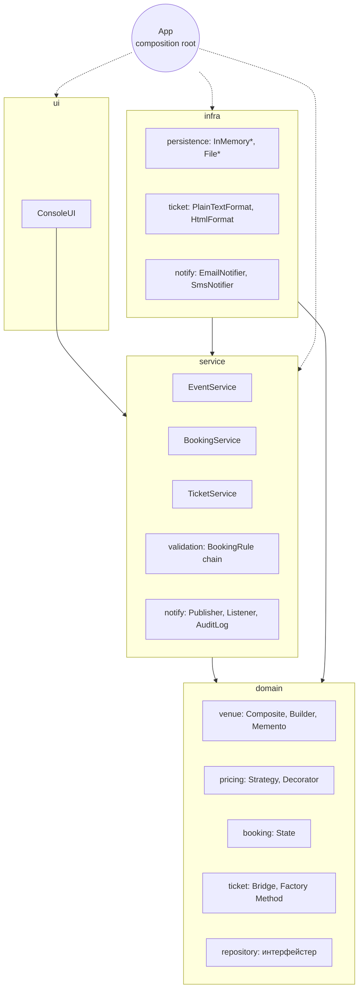

# Іс-шараларға билет сату жүйесі

> Capstone project — Application Design Based on Patterns (Design Patterns), 4th year, Information Systems. Тақырып №6.

**Команда:** Кизат Хамза ([@hamzakizat19-bit](https://github.com/hamzakizat19-bit)), Арулан ([@nurkasymarulan1](https://github.com/nurkasymarulan1))
**Домен:** сатып алушылар іс-шараға орын таңдап, уақытша ұстап тұрып, промокодпен төлеп, электронды билет алады.

## Домен

Жүйе іс-шараларға (концерт, матч) билет сатады:

- **Іс-шаралар.** Әр іс-шараның өз алаңы және орындар картасы бар (Алаң → Сектор → Қатар → Орын).
- **Брондау.** Таңдалған орындар 10 минутқа *ұсталып тұрады*. Төленбесе, автоматты түрде босайды.
- **Тарифтер.** Бар тарифтер: толық баға, студенттік (-30%), ерте сатып алу (30+ күн бұрын, -20%). VIP орын базалық бағадан ×2 тұрады.
- **Промокодтар.** Пайыздық (`SALE10`) немесе тұрақты сомалық (`MINUS2000`) болады, қолдану саны шектеулі.
- **Электронды билеттер.** Стандарт және VIP түрлері бар, мәтін немесе HTML форматында шығарылады.
- **Хабарламалар.** Әр оқиға e-mail, SMS арқылы жіберіледі және журналға жазылады.
- **Бас тарту.** Төлегенге дейін де, кейін де бас тартуға болады. Орындар брондауға дейінгі күйіне дәл қайтарылады (Memento).

## Іске қосу

Қажет: **JDK 17+** және **Maven 3.9+**.

```powershell
mvn verify                                   # тесттер + ArchUnit + JaCoCo (≥60%)
mvn -q compile exec:java                     # консоль, деректер жадта
mvn -q compile exec:java -Dexec.args="--storage=file"   # деректер data/ қалтасында сақталады
```

VS Code-та F5 басып, «App (in-memory)» немесе «App (file storage)» конфигурациясын таңдаңыз.

> Windows консолінде қазақ әріптері дұрыс көрінуі үшін алдымен `chcp 65001` орындаңыз.

### Демо сценарий

1. `1` — іс-шаралар тізімін ашу.
2. `2` → `1` — орындар картасын көру: `o` бос, `h` ұсталған, `x` сатылған.
3. `3` → `1` → аты-жөні → `VIP-1-1, C-1-1` → Enter — орындарды ұстап тұру. Брондау нөмірі шығады.
4. `4` → нөмір → `SALE10` — промокод қолдану.
5. `5` → нөмір — төлеу.
6. `6` → нөмір → `html` — билеттерді шығару.
7. `7` → нөмір — бас тарту. Орындар картасы бұрынғы күйіне қайтады.

## Архитектура



Қабаттар және ережелер:

- Тәуелділіктер тек ішке қарай бағытталады: `ui → service → domain` және `infra → service/domain`.
- `domain` ешкімге тәуелді емес.
- Бұл ережелерді [ArchitectureTest](src/test/java/kz/kaznaru/capstone/ArchitectureTest.java) (ArchUnit) тексереді.
- Нақты кластар тек бір жерде, [App](src/main/java/kz/kaznaru/capstone/App.java) ішінде (composition root) таңдалып, өзара байланыстырылады.
- Деректер Repository интерфейстерінің артында сақталады. `--storage=file` параметрі in-memory репозиторийді файлдағы репозиторийге ауыстырады, ал сервистер өзгермейді.

## Үлгілер (қысқаша)

| Санат | Үлгілер |
|---|---|
| Creational | Factory Method, Builder |
| Structural | Composite, Decorator, Bridge |
| Behavioral | Strategy, State, Observer, Chain of Responsibility, Memento |
| Үйлесімдер | Strategy + Decorator (баға), Composite + Builder + Memento (орындар картасы), Bridge + Factory Method (билет) |
| Қабылданбаған | Singleton, Visitor, Command |

Толығырақ: [docs/PATTERN_REGISTER.md](docs/PATTERN_REGISTER.md), шешімдер: [docs/adr](docs/adr).

## Кеңейту нүктелері (Open/Closed)

Жаңа мүмкіндік тек жаңа класс жазып, оны `App` ішінде тіркеу арқылы қосылады:

| Не қосылады | Интерфейс | Мысал |
|---|---|---|
| Жаңа тариф | `PricingStrategy` | `ExtensionPointTest.PensionerPricing` |
| Жаңа хабарлама арнасы | `BookingListener` | `ExtensionPointTest.TelegramNotifier` |
| Жаңа билет форматы | `TicketFormat` | мысалы, `PdfFormat` |
| Жаңа тексеру ережесі | `BookingRule` | `BookingRuleChainTest` ішіндегі blacklist |
| Жаңа промокод түрі | `PriceDecorator` + `PromoType` | мысалы, «2 билетке 3-шісі тегін» |

## Құжаттар

- [docs/USER_STORIES.md](docs/USER_STORIES.md) — қабылдау критерийлері бар 10 user story
- [docs/PATTERN_REGISTER.md](docs/PATTERN_REGISTER.md) — үлгілер тізілімі
- [docs/adr](docs/adr) — архитектуралық шешімдер (ADR)
- [docs/MILESTONES.md](docs/MILESTONES.md) — M1–M5 кезеңдері және GitHub жоспары
- [docs/PRESENTATION.md](docs/PRESENTATION.md) — қорғауға арналған 8 слайд жоспары
- `docs/reflection-<github-handle>.md` — әр студенттің рефлексиясы (сұрақтар: [docs/REFLECTION.md](docs/REFLECTION.md))

## Қолданылған кітапханалар

Тек тест үшін қолданылады: JUnit 5, ArchUnit, JaCoCo (Maven плагині). Негізгі кодта сыртқы кітапхана жоқ.

## Команда жұмысы (Team workflow)

- Әр жұмыс issue-ден басталады: user story (#1–#10) немесе task. Барлығы [Event Ticketing Development Board](https://github.com/users/hamzakizat19-bit/projects/1) тақтасында (Backlog → Ready → In progress → In review → Done).
- Branch per issue, pull request per branch: `feature/<issue>-<қысқа-атау>`, `docs/<issue>-...`.
- `main` қорғалған: тек PR арқылы, екінші адамның 1 approve-ы және CI (`build`) жасыл болуы керек.
- Әр кезеңнің соңында тег: `v0.1` (M1) … `v1.0` (M5).
